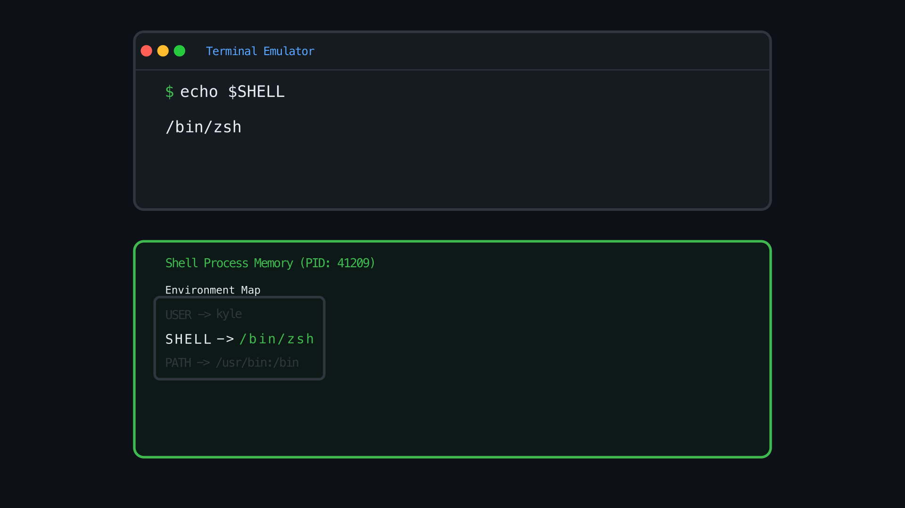

# shell-anatomy

Visual explanations of shell internals, process lifecycles, and environment resolution built with Manim Community Edition and automated voiceovers.



## Attribution and Disclaimer

This project is an educational thought experiment exploring programmatic video generation and automated speech synchronization.

* **Original Concept**: Inspired by Ryan Baker's video, ["How the Shell Works"](https://www.youtube.com/watch?v=hV3_XZXeDQo).
* **Animation Engine**: Built using Manim Community Edition, originally created by Grant Sanderson (3Blue1Brown) and maintained by the Manim Community.
* **Styling**: Styled after the terminal aesthetics of [kahdev.me](https://kahdev.me/).

## Prerequisites

* Python 3.11+
* [uv](https://github.com/astral-sh/uv)
* [ffmpeg](https://ffmpeg.org/)
* [sox](https://sox.sourceforge.net/) (for audio timing and manipulation, e.g. `brew install sox`)

## Environment Setup

Clone the repository and set up a virtual environment using `uv`:

```bash
uv venv
source .venv/bin/activate
uv pip install -e ".[dev,docs]"
```

## Rendering Scenes

Animations can be rendered across multiple resolutions and voiceover backends depending on your environment and API access.

### 1. Full Production Render (ElevenLabs)

Synthesizes voiceovers with the Brian voice (`eleven_multilingual_v2` model) and renders in 1080p high quality:

```bash
ELEVEN_API_KEY="sk_..." VOICEOVER_BACKEND=elevenlabs manim -pqh src/shell_anatomy/scenes/terminal_stack.py TerminalHierarchyScene
```

Requirements for ElevenLabs:
* An active API key with `text_to_speech` and `voices_read` permissions.
* Once generated, audio assets are automatically cached in `media/voiceovers/` for fast repeated renders.

### 2. Free Scratch Render (gTTS)

Uses Google Text-to-Speech to generate free audio without requiring third-party API tokens:

```bash
VOICEOVER_BACKEND=gtts manim -pql src/shell_anatomy/scenes/terminal_stack.py TerminalHierarchyScene
```

### 3. Offline Silent Render (Fast CI and Local Development)

Uses `SilentService` to produce word-count-timed silent audio with zero network requests:

```bash
VOICEOVER_BACKEND=none manim -pql src/shell_anatomy/scenes/terminal_stack.py TerminalHierarchyScene
```

## Customizing the Narration Script

Narration text is located in `src/shell_anatomy/scenes/terminal_stack.py` inside `construct()` within `with self.voiceover(text="..."):` context managers:

```python
with self.voiceover(
    text="When you type into a terminal window, the terminal emulator simply handles the visuals and accepts raw keystrokes."
):
    ...
```

Modifying strings inside `text="..."` will update the spoken script and trigger audio regeneration on subsequent renders.

## Tests

Execute the automated test suite using `pytest`:

```bash
pytest
```

## Documentation

Sphinx documentation is located in the `docs/` directory using the Furo theme.

To build the HTML documentation:

```bash
sphinx-build -b html docs docs/_build/html
```

Open `docs/_build/html/index.html` in your browser to view the generated reference guide.

## License

This project is licensed under the MIT License. See the [LICENSE](LICENSE) file for details.
